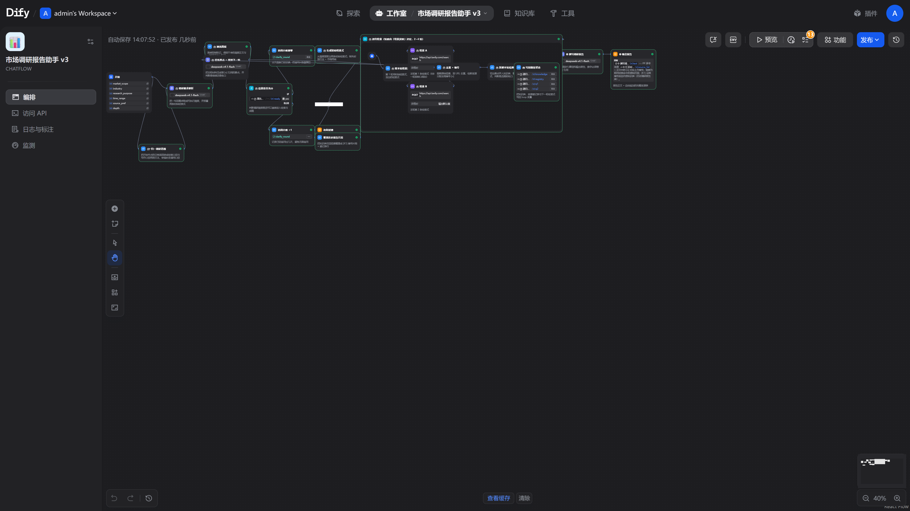
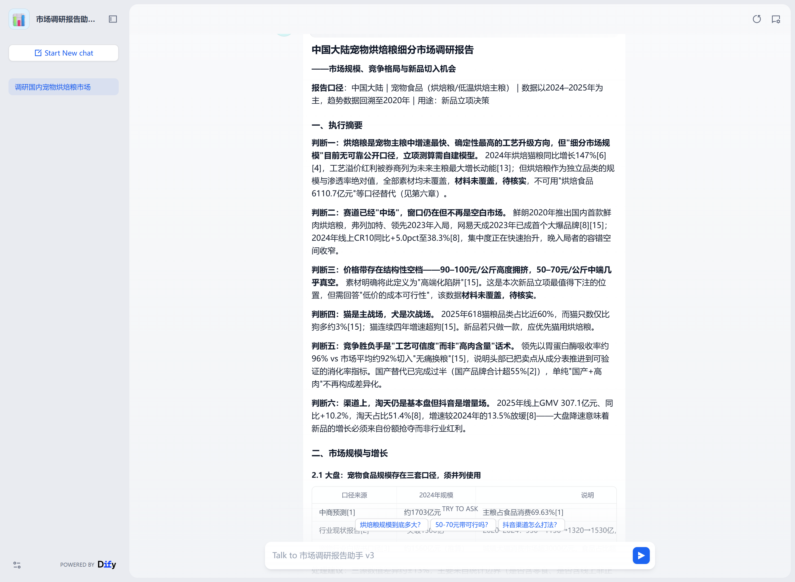
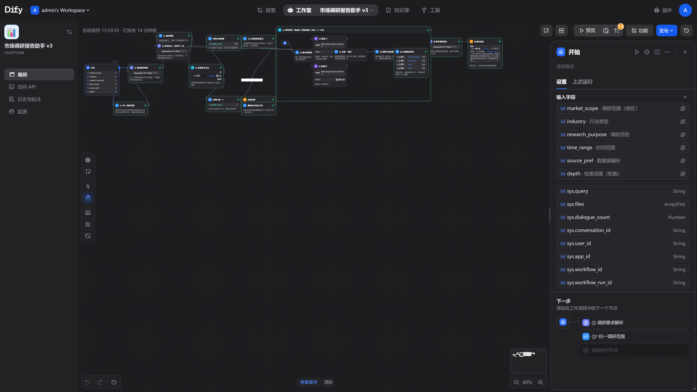
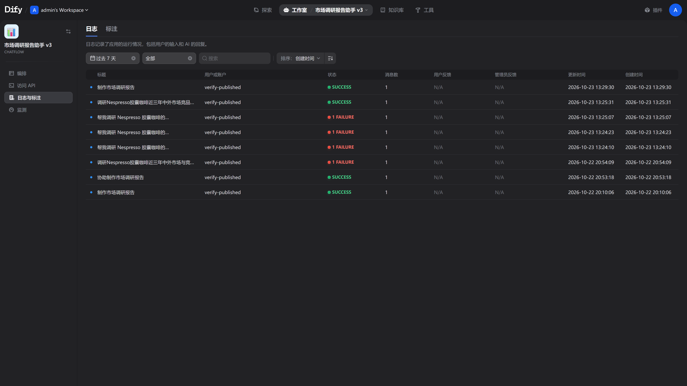

# 市场调研报告助手 · Market Research Assistant

把一句话需求（「调研 Nespresso 胶囊咖啡在中国市场的竞争格局」）变成一份**带编号引用、可溯源**的七章市场调研报告。

> 仓库地址：https://github.com/Ethan-upgrade/dify-market-research-assistant
> 上传/改名/私有化/开 CI 的操作见 [`docs/08-publish-github.md`](docs/08-publish-github.md)。

本仓库提供**两种完全等价的实现**，你可以只用其中一种：

| 路线 | 运行方式 | 适合谁 | 启动成本 |
|---|---|---|---|
| **A. Dify 工作流** | Dify 平台 + 导入 `dsl/*.yml` | 想可视化编排、给团队共用一个网页入口 | 中（需要一个 Dify 实例） |
| **B. 零依赖 CLI** | 纯 Python，`python -m mra "..."` | 想跑在服务器/本地/CI、不想维护 Dify | 低（Python 3.9+ 即可） |

两条路线共用同一套 prompt 与同一套节点逻辑，改一边记得同步另一边（代码里已标注对应关系）。

---

## 0. 先回答那个问题：Dify 只能在 Docker 里跑吗？

**不是。** Dify 官方推荐 Docker，但它本身是个普通的前后端项目，有四条路：

| 方式 | 要不要 Docker | 说明 | 代价 |
|---|---|---|---|
| **Dify Cloud** | 不要 | 官方托管版 cloud.dify.ai，注册即用，直接导入本仓库的 DSL | 数据出内网；免费额度有限 |
| **源码安装** | 不要 | `api/` 用 `uv` 起 FastAPI + Celery worker，`web/` 用 `pnpm` 构建；中间件（PostgreSQL+pgvector、Redis、向量库、Sandbox、Plugin Daemon）需自己装 | 中间件多，Windows 上尤其磨人；约 1~2 天 |
| **Docker Compose** | 要 | `docker/docker-compose.yaml` 一把梭，11 个容器 | 吃内存（约 8 GB）；Docker Desktop 自己不保活，重启/休眠后要拉起来 |
| **本仓库 standalone** | 不要 | 抽出核心流程的零依赖实现，`python -m mra` 直接出报告 | 没有可视化界面、没有多租户 |

**结论**：如果你要的是「稳定出报告」，用 **route B（standalone）**，它把 Docker 这个最大不稳定源直接摘掉了。如果你要的是「网页端可视化编排、团队共用」，才需要 Dify，且优先考虑 Dify Cloud，其次 Docker Compose。

> Docker 那条路踩过的坑（容器不自启、pgvector 镜像、插件守护进程、模型网关掉线）整理在 [`docs/07-troubleshooting.md`](docs/07-troubleshooting.md)。

---

## 1. 30 秒上手（route B，推荐）

```powershell
git clone <your-repo-url> market-research-assistant
cd market-research-assistant/standalone

# 1) 配置（也可以直接设环境变量）
copy ..\.env.example ..\.env      # 填写 MRA_API_KEY 与 TAVILY_API_KEY

# 2) 跑一份报告
python -m mra "调研胶囊咖啡在中国市场的竞争格局，用于新品立项决策" `
    --market 中国大陆 --industry 消费品/快消 --purpose 新品立项 --depth 3 `
    -o report.md
```

不需要任何第三方包：只用标准库（`urllib` / `json` / `re`）。
仓库根的 `.env` 会被**自动加载**（shell 里的环境变量优先），所以填一次就够，不用每次 export。

**没有 Tavily Key 也能先看效果**——用内置离线语料回放：

```powershell
python -m mra --search fixture --fixture tests/fixtures/corpus.json `
    "调研胶囊咖啡在中国市场的竞争格局" --depth 2
```

产物见 [`examples/offline-demo-report.md`](examples/offline-demo-report.md)（本仓库内置的一次真实运行结果，6 条来源全部被正文引用）。

模型只要兼容 OpenAI 的 `/chat/completions` 就行：DeepSeek、OpenAI、通义、智谱、Ollama、vLLM、LM Studio 都能接，见 `.env.example` 里的注释。

### 日常五种触发方式（详见 [docs/09-triggering.md](docs/09-triggering.md)）

出报告后会**自动降噪 + 体检**：

```
⑫ᵃ 引用降噪：[77 → 55 处标注
✓ 体检通过：9599 字 / 7 章 / 来源 19 条（引用 19，100%） / 标注 127 处（每百字 1.78）
```

体检项：控制标记泄漏、字数、章节数、悬空引用、自造标注（`[搜索A]`）、来源利用率、
**引用密度（>每百字 6 处）**、**一段内同一来源 >5 次**、**表格「来源」列空白**、**连续 4 个以上标注**。
不合格会逐条列出问题、退出码 1，但**报告保留**供人工复核。`--no-check` 关体检，`--no-normalize` 关降噪。

### 来源可核验（3.4 新增）

报告内部自洽 ≠ 来源能打开。加 `--verify-links` 会逐条抓取来源 URL：

```powershell
python -m mra "调研 XX 市场" --depth 2 --verify-links -o report.md
# 或对已有报告单独体检
python -m mra.verify report.md --workers 8
```

```
🔗 链接体检：15 条 → 正常 12，反爬 2，死链 1
   ✗ [4] https://www.iimedia.cn/c400/106703.html —— The read operation timed out
```

判定分五档：`OK`、`BOT`（反爬，不算死链）、`PDF`（二进制，无法文本比对）、`DEAD`（404/DNS/超时）。

**抓取引擎链（3.6）**：`urllib` 拿不到就自动换引擎，`--fetcher auto` 是默认。

| 层 | 项目 | GitHub 星 | 作用 |
|---|---|---|---|
| 1 | 标准库 urllib | — | 最快，能拿就拿 |
| 2 | [curl_cffi](https://github.com/lexiforest/curl_cffi) | 6.8k | 伪造 Chrome TLS 指纹，专治「UA 一样却 403」 |
| 3 | [playwright](https://github.com/microsoft/playwright) | 99k | 真 Chrome 内核，跑 JS / 过简单挑战 |
| 4 | [firecrawl](https://github.com/firecrawl/firecrawl) | 197k | 抓取服务，最重的兜底（需 Key 或自建） |
| PDF | [PyMuPDF](https://github.com/pymupdf/PyMuPDF) / [pypdf](https://github.com/py-pdf/pypdf) | 11k / 10.3k | 券商研报 PDF 直接抽文本，不再是「无法比对」 |

同一份报告（17 条来源）实测：

| 策略 | 正常 | 反爬 | PDF | 死链 |
|---|---|---|---|---|
| `--fetcher urllib` | 9 | 6 | 2 | 0 |
| `--fetcher curl_cffi` | 11 | 4 | 2 | 0 |
| `--fetcher auto` | **14** | **0** | 2 | 1 |

（`crawl4ai` 86.7k★ 也可以接，但它需要跑独立服务 + Playwright 浏览器，对「验几条链接」这件事太重，没纳入默认链。）
同时报告会自动做**编号连续化**（剔掉未引用来源后重排为 1..N，避免「11 直接跳 13」），
并把「Tavily 引擎摘要」单独列出、**不计入来源数**（它不是原始出处）。

### 数字溯源（3.5 新增）

链接打得开，不代表数字真是那篇文章说的。`mra.trace` 只查**表格**（一行一个来源，归属无歧义），
逐行把数字拿去网页正文里比对：

```powershell
python -m mra.trace report.md --workers 8
```

```
表格论断 32 条 / 数字 75 个
  · 整行数字都能在原文找到：9 行
  · 有数字没找到（需人工复核，可能是改口径/换单位/四舍五入）：10 行
  · 页面打不开（403/PDF/超时），无法判断：13 行
```

**它不做真假判决**，只把「页面上找不到的数字」挑出来，把人工复核从 32 行缩到 10 行。
正文句子级比对试过，误报率太高（模型自己算的同比、四舍五入都会被判错），所以只保留表格。

### 服务化：给 Dify / 飞书 / 其他系统调用（3.9）

```powershell
python -m mra.serve --port 8765        # 设了 MRA_TOKEN 就要求 Bearer 认证
```

| 接口 | 作用 |
|---|---|
| `GET /health` | 存活 + 版本 |
| `POST /check` `{"markdown": "..."}` | 跑报告体检，返回 ok/problems/metrics |
| `POST /verify` `{"markdown": "...", "links": true, "trace": false}` | 体检 + 链接 + 数字溯源 |

Dify 里怎么接：在 Answer 节点**之前**插一个 HTTP Request 节点，POST 到
`http://host.docker.internal:8765/check`，body 用上一步的报告文本；用返回的 `ok` 走条件分支——
不合格就转人工，不直接吐给用户。容器里 `127.0.0.1` 指向容器自己，必须用 `host.docker.internal`。

**长任务用异步接口**（3.10）：一份报告要 2~3 分钟，Dify 的 HTTP 节点默认超时扛不住。

```powershell
POST /research   {"query":"调研 XX 市场","market":"中国大陆","depth":"2"}
→ 202 {"job_id":"a1b2c3","status":"queued","poll":"/jobs/a1b2c3"}

GET /jobs/a1b2c3
→ {"status":"done","result":{"markdown":"…","check":{"ok":true,"metrics":{…}}}}
```

`status` 依次是 `queued → running → done | failed`；失败时 `error` 带原因。任务内存保存 1 小时、最多 100 个。

**抓取缓存（3.11）**：`verify` / `trace` 抓过的页面默认缓存 24 小时（`.cache/fetch/`，按 URL 哈希存）。
同一份报告反复体检不必重抓：实测单页 3.07s → 0.00s。`MRA_FETCH_TTL=0` 关闭。

**智能识别范围（3.14）**：

```powershell
python -m mra "德语学习周期、学习方法与未来应用前景，尤其以职业为导向" --smart
# 智能识别范围：industry=教育｜purpose=行业概览
```

`--smart` 用关键词规则，**0 token、毫秒级**；`--auto-scope` 用小模型调用推断（约 1~2k tokens），更准。
没认出来的词不会再报错退出，而是按「自定义口径」原样写进检索式。

**篇幅压缩（3.13，可选）**：`--max-chars 12000` 会多调一次模型做压缩，但**实测效果有限**
（17216 → 15049，仅 -2.5%，且常被「丢引用/结构不合规」的守卫拒绝）。报告本身没有重复段落，
所以默认关闭（`--max-chars 0`）；建议靠 prompt 控制在 8000~16000 字，而不是事后压缩。

**常驻自启（3.12）**：不想每次手动起服务，注册成登录自启的计划任务：

```powershell
tools\install-serve-task.ps1                 # 登录后 20s 启动，端口 8765
tools\install-serve-task.ps1 -Port 9000 -Token mytoken
tools\install-serve-task.ps1 -Remove         # 撤销
```

失败每分钟自动重启（`RestartCount 999`），日志写 `logs\serve.log`。本机实测：注册 → `Start-ScheduledTask` →
`curl /health` 返回 `{"ok": true, "version": "3.12.0"}` → 删除任务、端口释放。

| 方式 | 命令 | 场景 |
|---|---|---|
| 命令行 | `python -m mra "调研 XX 市场" --depth 3 -o r.md` | 随手问 |
| 参数简写 | `--market 全球 --industry 教育 --purpose 全部` | 不用背枚举值（3.13.1） |
| 自动识别 | `python -m mra "德语学习前景" --smart` | 从需求里猜范围，0 token（3.14） |
| 双击 | `tools\run-report.cmd` | 不想敲命令，问几个问题就出报告 |
| 批量 | 编辑 `topics.txt` → `tools\batch-run.cmd` | 一次跑一串主题 |
| 定时 | `tools\install-task.ps1 -Time 09:00 -Weekly Monday` | 周报自动出 |
| 网页 / API | http://127.0.0.1:8080/apps | 团队共用、给别的系统调 |

---

## 2. 仓库结构

```
.
├─ dsl/                                   # route A：Dify DSL，控制台直接导入
│  ├─ market-research-assistant.yml       #   v1 基础版（9 节点）
│  ├─ market-research-assistant-v2.yml    #   v2 固定两轮 + 缺口补搜（16 节点）
│  └─ market-research-assistant-v3.yml    #   v3 递归检索 + 全局编号（26 节点，推荐）
├─ standalone/                            # route B：零依赖实现
│  ├─ mra/
│  │  ├─ config.py     # 6 个调研范围维度 + 环境变量
│  │  ├─ prompts.py    # 三份 prompt，与 DSL 逐字一致
│  │  ├─ nodes.py      # 纯函数节点（去重编号/覆盖度判断/来源表…）
│  │  ├─ search.py     # Tavily 后端 + 离线 fixture 后端
│  │  ├─ llm.py        # OpenAI 兼容 chat 客户端（含重试）
│  │  ├─ pipeline.py   # 编排：需求解析 → 递归检索 → 撰写 → 引用表
│  │  └─ cli.py        # 命令行入口
│  └─ tests/           # 153 个用例：节点/编排/体检/整理/链接/溯源/抓取/PDF/服务/压缩
├─ docs/                                  # 部署 / 架构 / 范围口径 / 排错 / 发布
├─ examples/                              # 实跑报告样例
├─ screenshots/                           # Dify 工作流截图
├─ scripts/                               # Dify 侧运维脚本（导入/发布/验证/自启）
├─ tools/                                 # 日常触发：双击跑 / 批量 / 定时任务 / mra 命令
├─ topics.txt                             # 批量跑的主题清单（一行一个）
├─ reports/                               # 报告输出目录（已 gitignore）
└─ .github/workflows/ci.yml               # 单测 + DSL 结构校验（已在跑）
```

---

## 3. 它到底做了什么

二十六个节点的链路（v3）压成一句话：**先判问题够不够清楚 → 递归检索（每轮重新规划）→ 把材料编号 → 用真实编号写报告 → 按实际引用生成来源表**。

| 能力 | 实现方式 | 效果 |
|---|---|---|
| **调研范围界定** | 6 个维度（地区/行业/目的/时间/数据源/轮数）进入 prompt，真实约束检索式与报告口径 | 同一句话选「中国大陆」和「北美」，检索式与结论落点不同 |
| **递归检索** | Loop 节点真循环；每轮从「已获知识」推断缺口，生成**不重复**的新检索式 | 实测 3 轮 6 条检索式全不相同；来源从 7 条提升到 31 条 |
| **全局编号引用** | 去重表 `url → [n]`，跨轮次持续累积 | 正文 `[3]` 与来源表第 3 条一一对应，零悬空引用 |
| **内部知识库（RAG）** | 知识库节点召回历史报告，片段编号 `[K1]`，带相关性门控 | 无关主题自动丢弃，避免「硬凑内部资料」 |
| **跑题拦截** | 首轮后若登记表零来源，或模型判定材料无关 → 反问而不是硬写 | 只回一句追问（约 200 字），不再凭空编万字长文 |
| **来源利用率** | 写完后把「未被引用的编号」回灌给模型要求覆盖 | 实测 24+4 条来源 100% 被引用 |

三版差异、以及每个设计借鉴了哪些高星开源项目（dzhng/deep-research、assafelovic/gpt-researcher），见 [`docs/04-architecture.md`](docs/04-architecture.md)。

### 界面截图

| 工作流画布（v3） | 对话页 |
|---|---|
|  |  |

| 开始节点：6 个调研范围 | 运行日志 |
|---|---|
|  |  |

---

## 4. 用 Dify（route A）

1. **准备一个 Dify**（1.9+）：Dify Cloud，或本地 Docker Compose（见 [`docs/02-deploy-docker.md`](docs/02-deploy-docker.md)）。
2. **装模型**：设置 → 模型供应商 → 填一个 OpenAI 兼容的 Key。
3. **导入 DSL**：工作室 → 创建应用 → 导入 DSL 文件 → 选 `dsl/market-research-assistant-v3.yml`。
4. **填两个环境变量**（应用内「环境变量」面板）：`TAVILY_API_KEY`（必填）。
5. **发布 → 运行**。

也可以全自动（走控制台 API）：

```powershell
$env:DIFY_EMAIL="you@example.com"; $env:DIFY_PASSWORD="***"; $env:TAVILY_KEY="tvly-***"
python scripts\deploy_v3.py --base http://127.0.0.1:8080 --file dsl\market-research-assistant-v3.yml --publish
python scripts\verify_published.py --base http://127.0.0.1:8080 --mode smoke
```

`scripts/` 里的脚本**只从环境变量取凭据**，不写死任何账号密码。

---

## 5. 配置项

| 变量 | 默认 | 说明 |
|---|---|---|
| `MRA_BASE_URL` | `https://api.deepseek.com/v1` | OpenAI 兼容的 base_url |
| `MRA_API_KEY` | — | 模型 Key |
| `MRA_MODEL` | `deepseek-chat` | 模型名 |
| `MRA_TEMPERATURE` / `MRA_MAX_TOKENS` | `0.7` / `16384` | 采样参数 |
| `TAVILY_API_KEY` | — | 联网检索（https://app.tavily.com 免费 1000 credits/月） |
| `MRA_SEARCH_DEPTH` / `MRA_MAX_RESULTS` | `advanced` / `6` | 每次检索条数与深度 |
| `MRA_SEARCH_BACKEND` | `tavily` | 设为 `fixture` 走离线语料 |

成本参考：一次 `--depth 3` 的调研 ≈ 12 Tavily credits + 约 6 万 tokens。

---

## 6. 已验证什么

- `standalone/tests` **153 个用例全绿**（节点逻辑、编排、`.env`、体检、引用整理、链接体检、数字溯源、抓取引擎链、PDF 抽取、抓取缓存、HTTP 服务与异步任务、Tavily 契约）。
- **GitHub Actions 已跑通**（Python 3.9 / 3.11 / 3.13 三档 + DSL 结构校验），最近一次 push 为绿。
- **仓库里的 v3 DSL 在 Dify 1.9.1 上实测**：导入 → 26 节点全部实例化 → 模型接线 → 发布成功 → smoke 验证通过（走追问分支、无控制标记泄漏）。
- **已发布版 full 回归**：14396 字 / 8 个二级标题 / 46 条来源（42 网页 + 4 知识库片段）/ 引用率 100% / 零悬空引用 / 零自造标注。
- `examples/offline-demo-report.md` 是本仓库中真实跑出来的产物：7.6k 字、6 条来源、正文引用 6 条、零悬空编号。
- DSL 三版在 Dify 1.9.1 上导入/发布/端到端实跑通过（含知识库接入与发布版 API 调用），细节见 `docs/` 与 `scripts/`。

---

## 7. 免责与许可

`standalone/tests/fixtures/corpus.json` 与 `examples/offline-demo-report.md` 中的数字为**合成示例数据**，仅用于验证流程，不得用于任何决策。

MIT，见 [LICENSE](LICENSE)。
